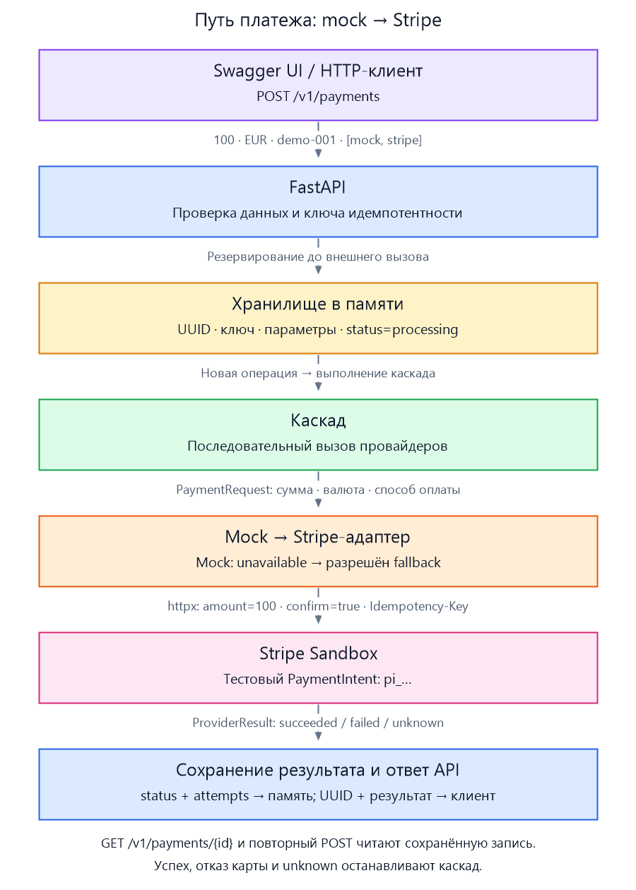

## Каскадирование платежей

### Задача

Спроектировать систему каскадирования платежей с любым тестовым провайдером.
Допустимый результат — архитектурный план с техническими решениями или прототип.

### Реализация

Компактное демо на Python 3.13 и FastAPI: Stripe Sandbox, mock-провайдер,
хранение платежей и ключей идемпотентности в памяти. Зависимости управляются через uv.

Два endpoint: `POST /v1/payments` создаёт платёж, `GET /v1/payments/{payment_id}`
возвращает сохранённый статус. Каскад выполняется внутри POST.
Следующий провайдер вызывается только после гарантированного отказа до обработки;
успех, отказ карты и неопределённый результат останавливают каскад.



## Запуск

Нужны Python 3.13, uv и тестовый ключ Stripe Sandbox. Из корня проекта:

```powershell
uv sync --locked --python 3.13
```

Создайте `.env` по образцу `.env.example` и укажите свой ключ:

```dotenv
STRIPE_API_KEY=sk_test_...
```

```powershell
uv run uvicorn app.main:app --host 127.0.0.1 --port 8000
```

Откройте [Swagger UI](http://127.0.0.1:8000/docs).
Приложение работает в одном процессе; после перезапуска данные теряются.

## Тесты

```powershell
uv run python -m unittest discover -s tests/unit -v
```

19 тестов проверяют Stripe-клиент, правила каскада, API и идемпотентность,
включая одновременные запросы. Ответы Stripe подменяются; ключ и запущенный сервер не нужны.

[Подробная документация](./docs/DETAILS.md)
